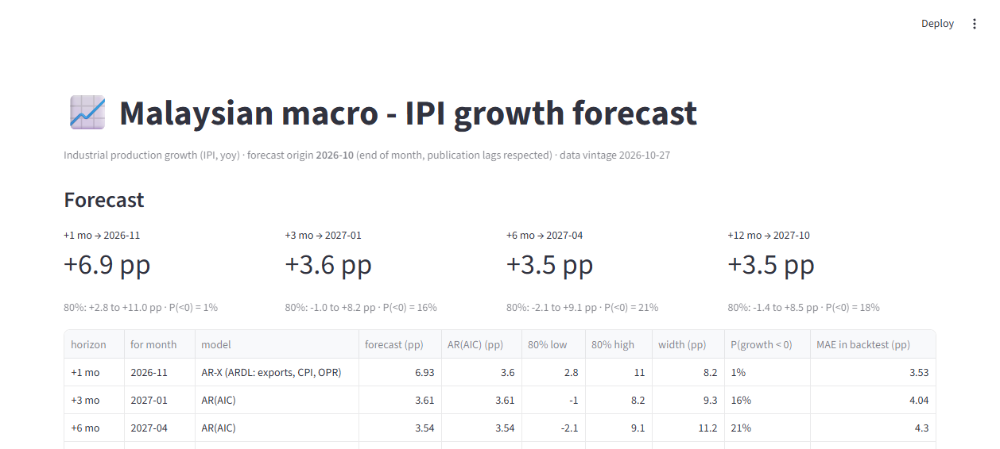

# ML Economic 1 (Ajey) - Malaysian Macroeconomic Intelligence Engine

Forecasting Malaysian economic conditions 3-12 months ahead, with the validation discipline
that makes the numbers survive a technical interview.

**Repo:** https://github.com/Ajeyygambit/ml-economic-1 (private)

**Primary target:** industrial production growth (IPI, yoy), horizons h = 1, 3, 6, 12 months.
**Secondary:** manufacturing IPI, CPI inflation, unemployment; regime detection; scenario shocks.

## Status

| stage | state |
|---|---|
| Data acquisition (13 official catalogues + BNM OPR history) | done |
| Monthly panel 2015-01 to 2026-10, 33 series + 46 GDP quarters | done |
| Data dictionary with verified checkpoints | done |
| Publication-lag (availability) mask + self-check | done |
| Leakage policy document | done |
| Exploratory analysis (stationarity, breaks, seasonality, collinearity) | done - `reports/eda.md` |
| Econometric baselines + LightGBM, rolling-origin, Diebold-Mariano | done - `reports/model_comparison.md` |
| Nested hyperparameter selection | done - `reports/model_comparison.md` §7 |
| Probabilistic intervals (quantile + conformal, coverage audit) | done - `reports/intervals.md` |
| AR-X / VAR comparison | done - `reports/arx_var.md` |
| Volatility regimes (Markov switching, real-time labels) | done - `reports/regime.md` |
| Streamlit decision-support app | done - `app/streamlit_app.py` |
| Technical report, demo video | next |

**Current honest result.** Point forecasts: AR-X (ARDL with exports, CPI, OPR) wins at h=1 - MASE 0.591 vs AR 0.758 on matched origins - while at h=3/6/12 nothing beats the plain AR(AIC) and all pairwise tests are non-significant. VAR never wins once a stability guard and matched origins are enforced. Intervals: quantile LightGBM under-covers (0.64 against a nominal 0.80), conformal over-covers (0.88-0.93); an 80% interval is 11-17 pp wide against a series with sd 6.6 pp. Volatility regimes: forecast error is 2.4x larger in the turbulent state at h=1 (p=0.006) but the effect is not monotone across horizons. Read `reports/model_comparison.md`, `reports/intervals.md`, `reports/arx_var.md` and `reports/regime.md` before quoting any number.

## Running it in VS Code (no copy-pasting)

The code lives in the repository; you open the folder rather than pasting files.

1. **File → Open Folder** → `C:\Users\User\Projects\ml-economic-1`
   (or clone the private repo first: `git clone https://github.com/Ajeyygambit/ml-economic-1`)
2. **Terminal → New Terminal**, then:
   ```bash
   python -m venv .venv
   .venv\Scripts\activate          # Windows PowerShell/cmd
   pip install -r requirements.txt
   ```
3. **Ctrl+Shift+P → "Python: Select Interpreter"** → choose `.venv\Scripts\python.exe`.
   Do not point it at another environment — the versions matter (`statsmodels` 0.15 changed
   the Markov-switching API this repo relies on).
4. Run any script: `python scripts/eda.py`, or the app: `streamlit run app/streamlit_app.py`
   and Ctrl+click the `localhost:8501` link it prints.

`data/` ships with the exact vintage the reports were built on, so every analysis script runs
without re-downloading anything. `scripts/fetch_data.py` and `scripts/fetch_opr.py` are the only
network-dependent steps, and both are stdlib-only.

## Quick start

```bash
python scripts/fetch_data.py             # pull 13 catalogues -> data/panel_monthly.csv
python scripts/fetch_opr.py              # BNM OPR decision history -> data/opr_monthly.csv
python scripts/fetch_data.py             # re-run so the panel picks up OPR
python scripts/build_publication_lag.py  # rebuild lag table from live data
python scripts/check_availability.py     # MUST print PASS before any modelling
python scripts/eda.py                    # stationarity, breaks, seasonality, collinearity
python scripts/backtest.py               # baselines + LightGBM, rolling origin
python scripts/tune_lgbm.py              # configuration sensitivity (post-hoc, for reference)
python scripts/nested_select.py          # honest selection - the quotable result
python scripts/intervals.py              # quantile + conformal intervals, coverage audit
```

No dependencies beyond the standard library for the acquisition scripts; `pandas` is needed
for the availability checker and later modelling stages.

## Application

```bash
streamlit run app/streamlit_app.py     # http://localhost:8501
```

Publishes the four horizons with the champion model per horizon (AR-X at h=1, AR(AIC) beyond),
conformal intervals with their width shown, P(growth < 0), the real-time volatility regime, and
scenario shocks through the AR-X channel. Every caveat the report makes is on the page: the AR-X
explains only 5% of the variance at h=1, its OPR coefficient is a six-value rate dummy, the two
specifications disagree by 3.3 pp at h=1, and the intervals are wide. A markdown brief is
downloadable.



## Layout

```
app/
  streamlit_app.py           decision-support UI (forecasts, intervals, regime, scenarios)
scripts/
  fetch_data.py              13 catalogues -> panel (stdlib only, every URL logged)
  fetch_opr.py               BNM MPC decisions -> stepped OPR series (+ self-check)
  build_publication_lag.py   measured release lags -> data/publication_lag.csv
  check_availability.py      enforcement + proof that no series leaks forward
data/
  panel_monthly.csv          142 months x 33 series
  panel_quarterly.csv        46 quarters (GDP)
  panel.xlsx                 monthly + quarterly + source manifest, one workbook
  publication_lag.csv        lag_months per series (the mask)
  opr_monthly.csv            OPR in force per month
  manifest.json              source URL, fetch timestamp, row counts, coverage
  DATA_DICTIONARY.md         every column: definition, unit, source, coverage, caveats
  raw/                       verbatim per-catalogue downloads (audit trail)
docs/
  leakage_policy.md          the six leak routes and how each is blocked
  notion_page.md             copy of the Notion project page
```

## The rule that governs everything

A forecast made at the end of month `T` may only use values published by then:
series `s` is usable up to `T - lag(s)`. At `T = 2026-10` the newest usable IPI is `2026-08`,
so a "1-month-ahead" forecast is really a forecast of `2026-11`. See `docs/leakage_policy.md`.

**Not solved:** revisions. No public real-time vintage database exists for Malaysia, so results
use a fixed vintage with a documented sensitivity band.
